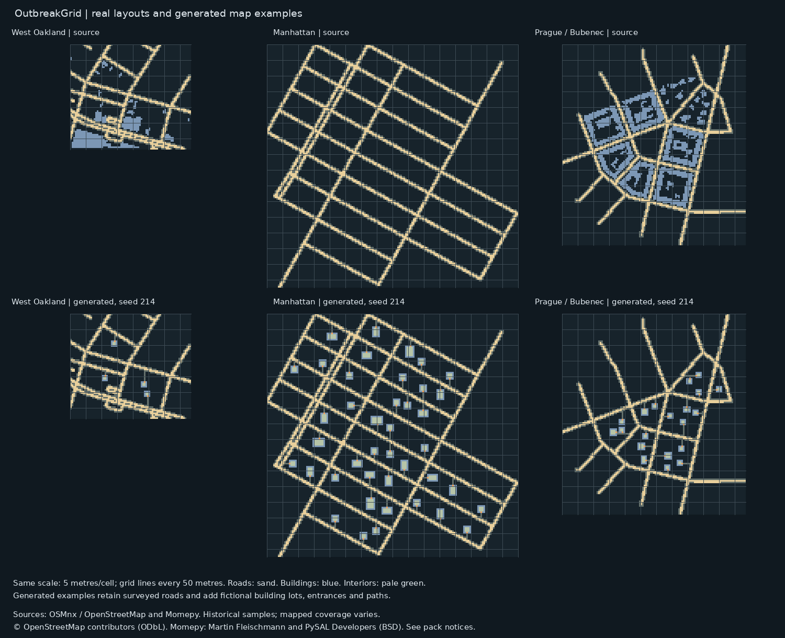

# OutbreakGrid city reference pack

Download **CityReferencePack.zip** from this folder, extract it, then open **CityReferences/atlas/index.html**.

The pack contains historical map references for West Oakland, Manhattan and Prague/Bubeneč, a shared 5-metre grid, measurements, source attribution, three source terrain templates and three seeded generated maps. Generated maps retain surveyed roads and add fictional building lots, interiors, doors and paths. No population or assigned roles are included.

Use **Load Map** in OutbreakGrid for the `.obmap2` files in `CityReferences/generated/`.

The six additional city/suburb surveys listed in the pack are pending network access. Native Unity rendering has not been verified. See the pack's README and NOTICE for exact scope and provenance.
