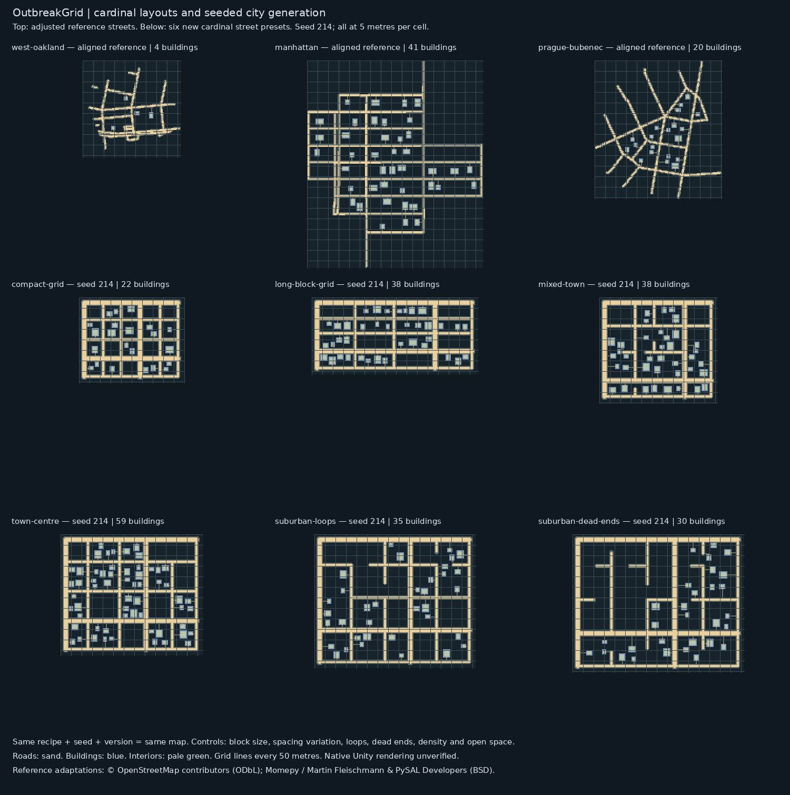

# OutbreakGrid cardinal city pack · version 2

**Download [CardinalCityPack-v2.zip](CardinalCityPack-v2.zip)**, extract it, then open `CityReferences/cardinal/index.html`.

Includes 11 new maps: three reference layouts rotated toward game cardinal axes, six newly generated cardinal street presets, and two additional seed comparisons.

The presets are compact grid, long-block grid, mixed town, town centre, suburban loops and suburban dead ends. All new street segments are horizontal/vertical, with a connected backbone. Each building has an interior, door and path. The aligned real references preserve secondary angles and rotate geographic north.

Every new preset map includes a complete replayable recipe. Controls cover seed, block counts and dimensions, variation, connecting loops, dead ends, road widths, sidewalks, density, setbacks, open space and centre density. Seeds change streets and lots; the same recipe and pinned generator reproduce the same map bytes. See `CardinalCityRecipes/` for the example JSON files and the ZIP README for exact commands.

Validation: 18 Python regression tests pass; the production C# reader loads all 11 maps, validates separate shelter rooms, round-trips them and executes actor ticks. All eight newly generated maps passed exact recipe replay. These are map-generation tools and unpopulated maps; native Unity rendering is unverified.

Original reference pack: [CityReferencePack.zip](CityReferencePack.zip).
