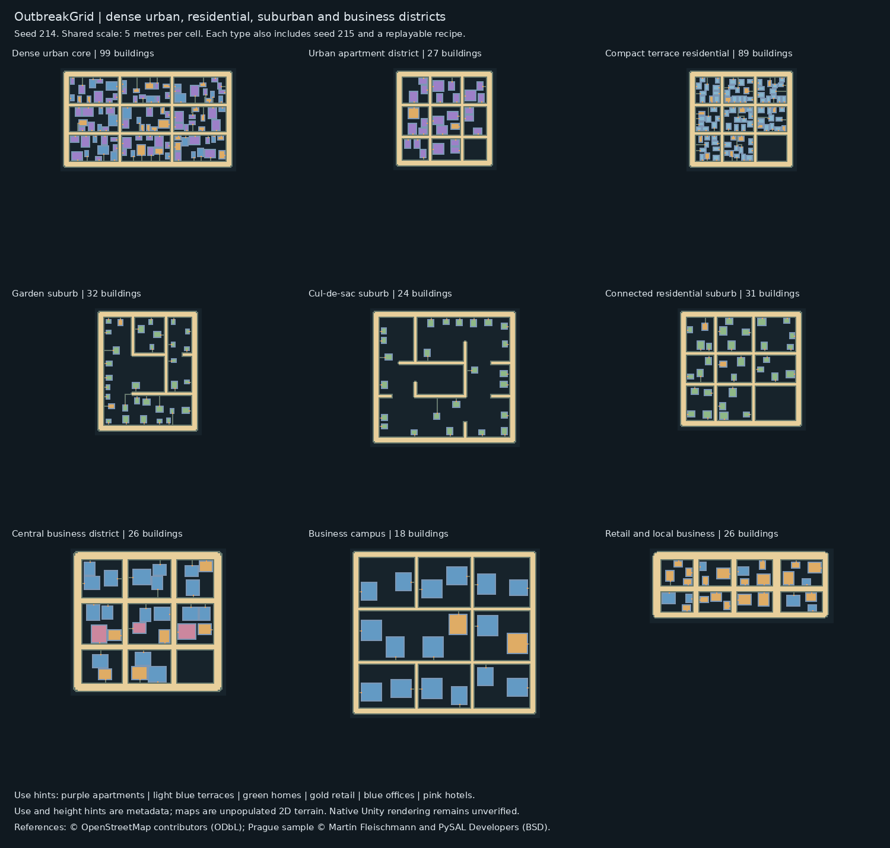
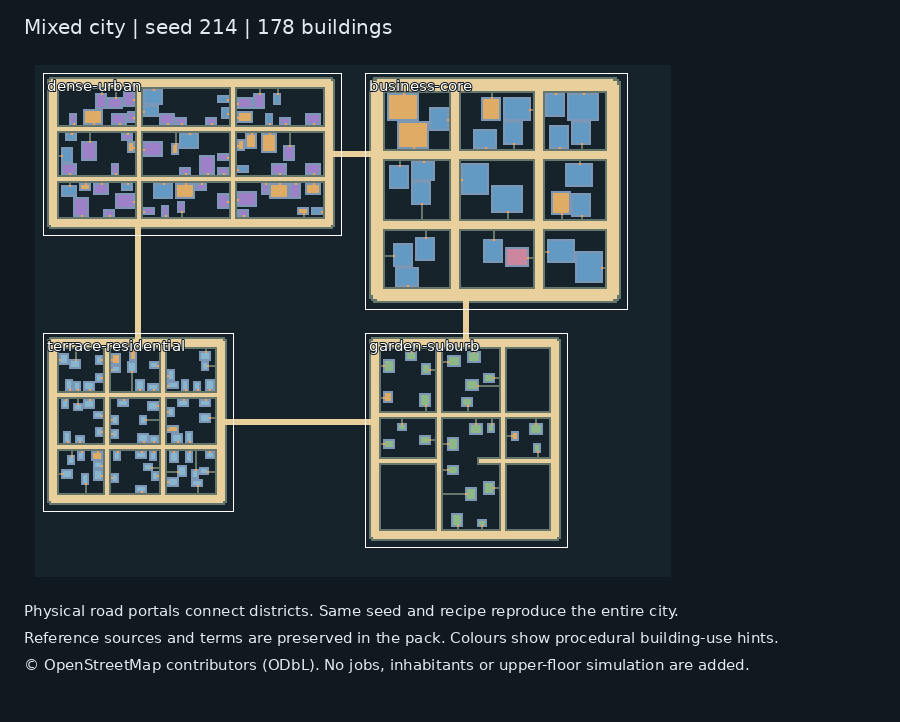

# OutbreakGrid procedural district library · version 3

**[Download DistrictCityPack-v3.zip](DistrictCityPack-v3.zip)**, extract it, then open `CityReferences/districts/index.html`.

Five new OpenStreetMap survey windows: Midtown Manhattan, Chicago Loop, Philadelphia residential rowhouses, Irvine/Woodbridge and Naperville. Original source geometry, measured profiles, timestamps, hashes and attribution are included.

Nine reusable district types: dense urban, urban apartments, terrace residential, garden suburb, cul-de-sac suburb, connected suburban grid, central business, business campus and retail corridor. The apartment reference uses the published Prague/Bubeneč sample; the business campus is explicitly designed.

Twenty maps: each district at seeds 214 and 215, plus two connected mixed-city examples. Complete recipes reproduce the maps. A mixed city preserves district identities and joins their roads with physical portals. Building metadata includes stable parcel IDs, use hints and design storeys.





## Generate or compose districts

The map tools and data are also available directly in this branch under [OutbreakRebuild/Tools](../OutbreakRebuild/Tools) and [OutbreakRebuild/CityReferences](../OutbreakRebuild/CityReferences). Use an environment with `Tools/requirements-atlas.txt` installed, from `OutbreakRebuild`:

```bash
python Tools/generate_district_city.py district --type dense-urban --seed 12345
python Tools/generate_district_city.py city --seed 12345 --districts dense-urban business-core terrace-residential garden-suburb
python Tools/generate_district_city.py replay path/to/exported.recipe.json
```

See [the district README](../OutbreakRebuild/CityReferences/districts/README.md) and [catalogue](../OutbreakRebuild/CityReferences/district_catalogue.json) for controls and source details.

Validation: 24 Python tests pass both in the checkout and after extracting the pack. All 20 generated maps and all eight reference terrain templates pass the production C# map-reader checks. Each example is checked for exact recipe replay. The previous v2 compact-grid map also remains byte-for-byte reproducible.

These are unpopulated 2D maps and procedural hints. No NPC jobs, inventories, directed traffic lanes or usable upper floors are added. Native Unity rendering remains unverified. The main branch and game behavior are not changed by this publication.

Earlier packs: [CardinalCityPack-v2.zip](CardinalCityPack-v2.zip) · [CityReferencePack.zip](CityReferencePack.zip).
